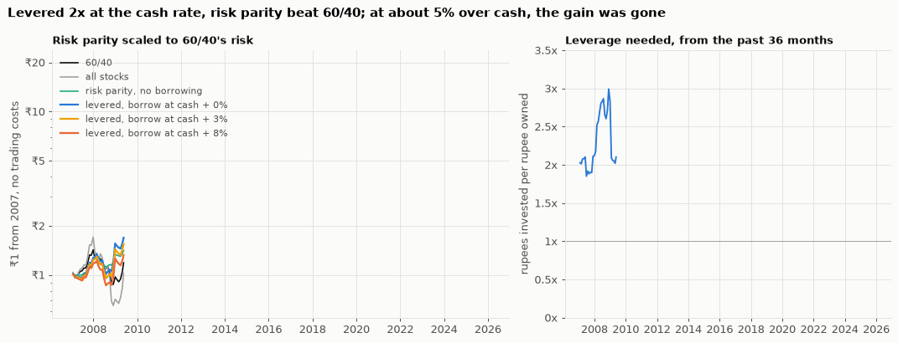
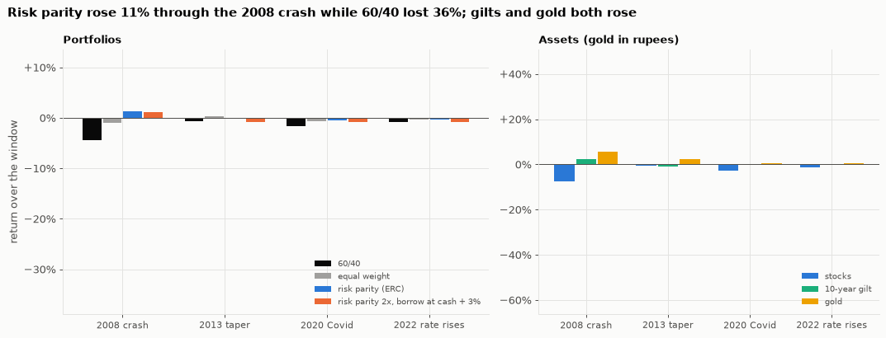
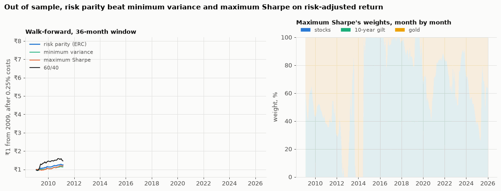
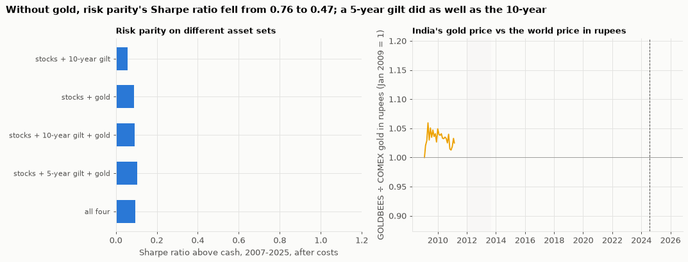
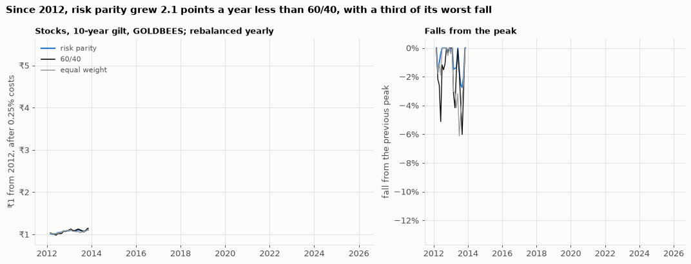

# Risk Parity

[](https://github.com/Dhirajdas18/risk-parity/actions/workflows/ci.yml)
[](https://dhirajdas18.github.io/risk-parity/)

Risk parity across Indian stocks, government bonds and gold, January 2004 to December 2025: stocks
and cash from IIM Ahmedabad's factor library, gilt returns built from RBI's month-end yields, and
gold in rupees from Yahoo Finance. Equal risk contribution against 60/40, leverage, estimation and
rebalancing out of sample, crises, minimum variance and maximum Sharpe, and a verdict.

**Live risk parity lab: [dhirajdas18.github.io/risk-parity](https://dhirajdas18.github.io/risk-parity/)**,
pick the assets, the years and the estimation window, and see risk parity's weights, each asset's
share of risk and growth against 60/40 and equal weight, computed month by month in your browser.

## Features

- [x] What risk parity does: equal risk contribution against 60/40, equal weight and inverse volatility
- [x] Leverage: unlevered risk parity, borrowing at Indian rates, and a volatility target
- [x] Estimation window, EWMA and rebalancing frequency, after costs, out of sample
- [x] Crises: 2008, the 2013 taper, 2020 and 2022
- [x] Risk parity against minimum variance and maximum Sharpe, out of sample
- [x] Which assets: a short gilt, and how much gold's measurement matters
- [x] Verdict: a portfolio-construction rule for the reference model beyond stocks

## Findings

### 1. In 60/40, stocks carried 96% of the risk; risk parity spread it evenly

<a href="docs/img/basics.png"><picture><source media="(prefers-reduced-motion: reduce)" srcset="docs/img/basics.png"></picture></a>

Monthly returns in rupees, January 2004 to December 2025 (264 months): stocks are IIMA's broad
market including dividends; the 10-year gilt is a par bond bought at each month-end at RBI's yield
and repriced a month later at the yield for its shorter life, plus a month's coupon; gold is COMEX
gold futures times the rupee rate, which leaves out India's import duty (it tracked the GOLDBEES ETF
with a monthly correlation of 0.87 and 13.6% against 13.0% a year from 2009; see finding 6); cash is IIMA's
risk-free rate. An asset's risk contribution is its weight times its covariance with the portfolio;
equal risk contribution (ERC) weights make those contributions equal. Full-sample weights describe
the period with hindsight; the walk-forward sets each month's weights from the previous 36 months
only and holds them for the month (January 2007 to December 2025), with no costs.

- **The three assets barely moved together.** Monthly correlations were −0.01 (stocks and gilt),
  −0.05 (stocks and gold) and −0.09 (gilt and gold). Stocks compounded 14.9% a year with 21.7%
  volatility, gold 14.7% with 16.7%, the 10-year gilt 7.1% with 6.9%, cash 6.3%.
- **60/40 was a stock portfolio.** With 60% in stocks and 40% in the gilt, stocks carried 96% of the
  risk; an equal split still left them 61%.
- **Risk parity put most of the money in the calmest asset.** Its full-sample weights were 18%
  stocks, 58% gilt and 24% gold, each carrying a third of the risk; with correlations near zero,
  inverse volatility gave almost the same weights.
- **Walk-forward, risk parity matched 60/40's return with half the volatility.** It compounded
  11.6% a year against 11.3%, with volatility of 6.4% against 13.0%, a Sharpe ratio above cash of
  0.77 against 0.41 and a worst fall of −8% against −39%. Equal weight compounded 12.7% (Sharpe
  0.70, worst fall −18%).

### 2. Levered about 2x at the cash rate, risk parity beat 60/40; at about 5% over cash, the gain was gone

<a href="docs/img/leverage.png"><picture><source media="(prefers-reduced-motion: reduce)" srcset="docs/img/leverage.png"></picture></a>

Unlevered risk parity had half of 60/40's volatility, so to compare like with like it has to borrow.
Each month, the risk-parity portfolio is scaled so its forecast volatility equals 60/40's, both
forecast from the same past 36 months (leverage capped at 4 times, never reached), and the extra is
borrowed at IIMA's cash rate plus a spread; no trading costs, January 2007 to December 2025. Cash
compounded 6.4% a year over these months. For scale, Indian brokers' margin loans cost roughly
9.65% to 15% a year in 2025 ([ICICI Direct](https://www.icicidirect.com/margin-trading-funding),
[Zerodha](https://support.zerodha.com/category/trading-and-markets/margins/margin-trading-facility/articles/does-zerodha-offer-lower-mtf-interest-rate)),
3.9 to 9.2 points above 2025's cash rate of 5.8%. The test assumes the whole portfolio, gilts and gold included, can
be borrowed against.

- **It took about 2 times leverage.** On average ₹2.01 invested per rupee owned, between 1.47 and
  2.99 times; the most was in late 2008.
- **At the cash rate, levered risk parity beat 60/40.** It compounded 17.1% a year against 11.3%,
  with a worst fall of −25% against −39%. Its volatility came out at 14.6%, above 60/40's 13.0%,
  although the forecasts matched.
- **The borrowing rate decided the result.** Borrowing at cash + 3% gave 13.6% a year (Sharpe
  0.52); at cash + 8% it gave 8.1% (Sharpe 0.17), below 60/40's 11.3% and all stocks' 12.3%.
  Levered risk parity only grew as fast as 60/40 when borrowing cost 5.1% a year over cash, still
  with a smaller worst fall (−28%). That break-even sits inside the range of retail margin loans.
- **Without borrowing,** risk parity compounded 11.6% a year with 6.4% volatility and a worst fall
  of −8%: about 60/40's growth with half the swings.

### 3. Estimation choices moved risk parity by at most 0.7 points a year after costs; longer windows and yearly trades did best

<a href="docs/img/estimation.png"><picture><source media="(prefers-reduced-motion: reduce)" srcset="docs/img/estimation.png"></picture></a>

Eighteen versions of risk parity on stocks, the 10-year gilt and gold, all walk-forward over the same
204 months (January 2009 to December 2025, so even a 60-month window has data): the covariance
from the past 12, 36 or 60 months, either plain or with exponentially fading weights (a month 12
months old counts half as much as the latest), and trades every month, quarter or year back to the
target weights. Every rupee traded pays an assumed 0.25% one way; costs scale in proportion to it.
That is generous: buying an ETF through a zero-brokerage broker costs about 0.02% in stamp duty,
exchange and SEBI charges, and selling under 0.01%
([Zerodha charges](https://zerodha.com/charges); STT is 0.001% on selling most ETFs and nil on gold
and gilt ETFs, [Zerodha support](https://support.zerodha.com/category/account-opening/charges-at-zerodha/articles/stt-etfs)),
which leaves about 0.2% for the bid-ask spread, not measured here. Fund expense ratios and tax on
rebalancing gains are not included.

- **Every version compounded 10.8% to 11.5% a year after costs,** with volatility of 5.7% to 6.0%,
  Sharpe ratios of 0.73 to 0.83 and the same worst fall, −4%.
- **The differences were small but not luck.** The versions hold the same assets, so they move
  almost together. The best (60 months, fading, yearly) beat the worst (12 months, plain,
  quarterly) by 0.64 points a year on average, with a standard error of the paired monthly
  differences of 0.10 points.
- **Costs were small.** Monthly rebalancing on a 12-month window traded 40% of the portfolio a year
  and cost 0.20% a year; yearly rebalancing on 36 or 60 months traded 5% to 7% and cost 0.02% to
  0.04%.
- **Yearly rebalancing came out ahead before costs too:** on 36 months, plain, 11.4% a year against
  11.2% monthly, so costs explain little of its edge.
- **Fading weights changed little:** within 0.1 points a year of the plain version at
  every window and frequency.
- **60/40 did well in these months.** Starting after the 2008 crash, it compounded 12.8% a year with
  11.2% volatility (Sharpe 0.59, worst fall −14%), more growth than risk parity but less per unit of
  risk.

### 4. Risk parity rose 11% through the 2008 crash while 60/40 lost 36%; gilts and gold both rose

<a href="docs/img/crises.png"><picture><source media="(prefers-reduced-motion: reduce)" srcset="docs/img/crises.png"></picture></a>

Four stress windows, by month: the 2008 crash (January 2008 to February 2009), the 2013 taper scare
(June to August 2013), the Covid fall (February to March 2020) and the 2022 rate rises (January to
June 2022). Portfolios are walk-forward as in finding 1 (36-month window, monthly) and pay 0.25% per
rupee traded; the levered version is finding 2's (1.8 to 3.0 times in these windows), borrowing at
cash + 3% and paying the same 0.25% when its leverage changes. An asset's contribution is
its weight times its return, summed over the window's months.

| Window | 60/40 | Equal weight | Risk parity | Risk parity levered | Stocks | 10-year gilt | Gold (₹) |
|---|---|---|---|---|---|---|---|
| 2008 crash | −36.4% | −8.0% | **+11.2%** | +8.2% | −60.7% | +18.1% | +45.5% |
| 2013 taper | −5.9% | +2.4% | −1.9% | −6.9% | −5.2% | −7.0% | +19.8% |
| 2020 Covid | −13.3% | −5.4% | −3.3% | −7.1% | −23.2% | +2.6% | +5.3% |
| 2022 rate rises | −6.5% | −2.4% | −2.2% | −7.2% | −9.4% | −2.4% | +4.8% |

- **In 2008, gilts did more of the work than gold.** Of risk parity's +11.2%, the gilt contributed
  about +12.8 points, gold +9.3 and stocks −10.3.
- **In 2013, stocks and gilts fell together and only gold rose.** Gold's +19.8% in rupees was all the
  rupee: dollar gold rose 0.3% while the dollar rose 19.5% against the rupee. In 2008 the split
  was 12.8% from gold's dollar price and 29.1% from the rupee.
- **Across all 28 months when stocks fell more than 5%,** risk parity averaged −0.19% a month
  against 60/40's −5.03%. In the 32 months when stocks and the gilt both fell, risk parity averaged
  −0.93% against −2.58%, and gold averaged +2.38%.
- **Its weak spot was bond sell-offs.** In the 14 months the 10-year gilt fell more than 2%, risk
  parity averaged −0.40% while 60/40 gained 0.55%, because stocks rose 3.10% in those months.
- **Levered at cash + 3%, risk parity lost 6.9% to 7.2% in each window after 2008:** more than
  60/40 in 2013 and 2022, about half of 60/40's loss in 2020.

### 5. Out of sample, risk parity beat minimum variance and maximum Sharpe on risk-adjusted return

<a href="docs/img/optimisers.png"><picture><source media="(prefers-reduced-motion: reduce)" srcset="docs/img/optimisers.png"></picture></a>

Minimum variance picks the long-only weights with the lowest forecast volatility; maximum Sharpe
picks the weights with the highest forecast return per unit of volatility, using each asset's past
average return above past average cash. Risk parity uses no return forecast at all. All are
walk-forward from January 2009 (204 months), rebalanced monthly, paying 0.25% per rupee traded.

| 36-month window | Compounded a year | Volatility | Sharpe | Worst fall | Turnover a year |
|---|---|---|---|---|---|
| Risk parity | 11.1% | 5.8% | **0.79** | −4% | 18% |
| Minimum variance | 9.0% | 5.2% | 0.51 | −5% | 20% |
| Maximum Sharpe | 9.7% | 11.0% | 0.34 | −22% | 110% |
| 60/40 | 12.8% | 11.2% | 0.59 | −14% | 11% |

- **With a 60-month window the order held.** Risk parity's Sharpe ratio was 0.78, against 0.52 for
  minimum variance and 0.50 for maximum Sharpe.
- **The lead over minimum variance was clear; over maximum Sharpe, likely.** Tested on the paired
  monthly returns, risk parity's Sharpe ratio beat minimum variance's by 0.28 (standard error 0.11,
  t = 2.6) and maximum Sharpe's by 0.45 (0.21, t = 2.1); with 60 months, by 0.26 (t = 2.6) and
  0.28 (t = 1.6). Its lead over 60/40, 0.20, was one standard error (t = 1.0).
- **Maximum Sharpe chased past winners.** Its weights swung by about 30 points (standard deviation)
  and it traded 110% of the portfolio a year. In 36 of the 204 months it put over 90% in one asset:
  gold in 17 months of 2012 to 2014, stocks in 17 months of 2014 to 2016 and 2 of 2023.
- **Minimum variance hid in the gilt.** It held 77% in the 10-year gilt on average and had the lowest
  volatility, 5.2%, but compounded 2.1 points a year less than risk parity.
- **Hindsight shows what a perfect forecast was worth.** Maximum-Sharpe weights chosen from the whole
  2004-2025 sample (27% stocks, 33% gilt, 40% gold), which no one could have known in 2009, gave a
  Sharpe ratio of 0.82 from 2009, close to risk parity's 0.79 without any return forecast.

### 6. Without gold, risk parity's Sharpe ratio fell from 0.76 to 0.47; a 5-year gilt did as well as the 10-year

<a href="docs/img/assets.png"><picture><source media="(prefers-reduced-motion: reduce)" srcset="docs/img/assets.png"></picture></a>

Risk parity on five sets of assets, walk-forward from January 2007 (36-month window, monthly, 0.25%
per rupee traded). The 5-year gilt is built the same way as the 10-year, from RBI's yields. Then
how gold is measured: COMEX gold times the rupee leaves out India's import duty, which the GOLDBEES
ETF's price carries (along with its fees). India cut the duty from 15% to 6% from 24 July 2024
([World Gold Council](https://www.gold.org/goldhub/gold-focus/2024/07/indian-gold-import-duties-reduced-lowest-level-over-decade));
the 2012-2013 rises took it from 2% to 10% in steps.

| Asset set | Compounded a year | Volatility | Sharpe | Worst fall |
|---|---|---|---|---|
| Stocks + 10-year gilt | 9.8% | 7.2% | 0.47 | −10% |
| Stocks + gold | 15.6% | 12.5% | 0.73 | −25% |
| Stocks + 10-year gilt + gold | 11.5% | 6.4% | 0.76 | −8% |
| Stocks + 5-year gilt + gold | 10.7% | 4.8% | **0.85** | −5% |
| All four | 10.4% | 4.9% | 0.77 | −6% |

- **Gold mattered most.** Leaving it out cut the Sharpe ratio from 0.76 to 0.47 (paired standard
  error 0.15, t = −1.9) and lowered growth from 11.5% to 9.8% a year. Gold in rupees compounded
  14.7% a year over 2004-2025, about as much as stocks; a period of weaker gold would shrink this.
- **Bonds mattered for the falls.** Without a gilt, stocks and gold grew 15.6% a year but fell as far
  as −25%.
- **The 5-year gilt matched the 10-year per unit of risk.** Its Sharpe ratio was 0.85 against 0.76,
  a gap of one paired standard error (0.09, t = 1.0), with lower growth and lower volatility. Adding
  both gilts gave 0.77.
- **How gold is measured moved risk parity by about 0.4 points a year.** From February 2012, risk
  parity with COMEX gold compounded 10.9% a year (Sharpe 0.83) and with GOLDBEES 10.5% (0.78).
  Over February 2009 to December 2025, COMEX gold in rupees compounded 13.6% a year and GOLDBEES
  13.0%, with a monthly correlation of 0.87.
- **The duty shows in the ETF's price.** GOLDBEES fell 7.0% against COMEX gold in rupees over July
  2024, close to the 7.8% that the cut from 15% to 6% implies (1.06 ÷ 1.15). From December 2011 to
  December 2013 it gained 16.4%, more than the rise from 2% to 10% alone implies (about 8%).

### 7. Since 2012, risk parity grew 2.1 points a year less than 60/40, with a third of its worst fall

<a href="docs/img/verdict.png"><picture><source media="(prefers-reduced-motion: reduce)" srcset="docs/img/verdict.png"></picture></a>

The rule findings 1 to 6 point to, with gold an investor can buy: risk parity on stocks, the
10-year gilt and the GOLDBEES ETF, covariance from the past 36 months, rebalanced once a year,
without borrowing, paying 0.25% per rupee traded. It starts in February 2012, 36 months after
GOLDBEES' returns begin, and runs to December 2025 (167 months), against 60/40 and equal weight on
the same assets and costs. These settings were chosen after seeing 2007-2025, so this is a check of
the rule with investable gold, not a fresh out-of-sample test. Stocks are IIMA's index and the
gilt a constant-maturity bond, with no fund fees; GOLDBEES' price is after its fees, so risk parity
and equal weight carry a fee that 60/40 does not. Fund fees and tax (debt funds are taxed at slab
rates, gold ETF gains have their own rules) are left out.

| Feb 2012 - Dec 2025 | Compounded a year | Volatility | Sharpe | Worst fall | Turnover a year |
|---|---|---|---|---|---|
| Risk parity | 10.7% | 5.1% | 0.79 | −4% | 5% |
| 60/40 | 12.8% | 9.5% | 0.66 | −13% | 3% |
| Equal weight | 12.0% | 6.5% | 0.82 | −6% | 4% |

- **Risk parity was the calmest, not the richest.** It had about half of 60/40's volatility and a
  third of its worst fall, and grew 2.1 points a year less. Trading cost 0.02% a year.
- **The halves disagreed.** From February 2012 to December 2018 risk parity's Sharpe ratio was
  0.12 against 60/40's 0.47; from January 2019 to December 2025 it was 1.37 against 0.83.
- **Its Sharpe lead over 60/40 was not significant:** 0.13, with a paired standard error of 0.22.
- **Equal thirds did about as well.** With gold in the mix, equal weight's Sharpe ratio was 0.82
  against risk parity's 0.79 (difference −0.03, standard error 0.10), with more growth (12.0%) and
  a −6% worst fall.

## Verdict

| Question | Answer | Evidence |
|---|---|---|
| Does risk parity spread risk evenly? | Yes | 60/40's stocks carried 96% of its risk; risk parity's three assets a third each (finding 1) |
| Does it earn more than 60/40 without borrowing? | No | About the same 2007-2025 (11.6% against 11.3%), but from 2009, after the crash, 11.1% against 12.8%; 2.1 points a year less since 2012 (findings 1, 3, 7) |
| Does it earn more per unit of risk? | Probably, not proven | Sharpe 0.79 against 0.66 since 2012 (t = 0.6), and 0.12 against 0.47 in 2012-2018 (finding 7) |
| Does borrowing fix the return gap? | Only with cheap borrowing | Beat 60/40 below 5.1 points over cash; retail margin loans cost 3.9 to 9.2 points over (finding 2) |
| Do the estimation settings matter? | A little | All 18 versions within 0.7 points a year; longer windows and yearly trades did best (finding 3) |
| Does it protect in crises? | Yes, unlevered | +11% in 2008 against 60/40's −36%; −0.19% a month in stocks' worst months against −5.03% (finding 4) |
| Is it better than optimising on past returns? | Yes against minimum variance, likely against maximum Sharpe | Sharpe 0.79 against 0.51 (t = 2.6) and 0.34 (t = 2.1) (finding 5) |
| What matters most? | Holding gold, in this sample | Sharpe 0.76 with gold, 0.47 without, while gold earned about as much as stocks; equal thirds with gold about as good as risk parity (findings 6, 7) |

For a portfolio beyond Indian stocks: hold stocks, a gilt and gold, sized by risk (risk parity, or
simply equal thirds), rebalanced once a year, without borrowing at retail rates. Expect smaller
falls and, in strong stock markets, less growth than 60/40.

## Quick start

```bash
uv sync
uv run python scripts/fetch_data.py   # IIMA, RBI yields and Yahoo gold -> data/
uv run rp report verdict              # also: basics, leverage, estimation, crises, optimisers, assets
uv run python scripts/build_site.py   # risk parity lab -> site/index.html
uv run pytest
```

The data files are downloaded, not committed.

## Design

- `src/rp/iima.py`: IIM Ahmedabad's factor library (stocks and the risk-free rate).
- `src/rp/rbi.py`: RBI's month-end SGL yields by maturity from the Handbook editions.
- `src/rp/gold.py`: gold in rupees (COMEX gold times the rupee rate) and GOLDBEES from Yahoo, with
  retries.
- `src/rp/assets.py`: the monthly asset table; gilt returns by repricing a par bond.
- `src/rp/weights.py`: risk contributions, inverse volatility, equal risk contribution (cyclical
  coordinate descent), minimum variance and maximum Sharpe (SLSQP).
- `src/rp/backtest.py`: walk-forward portfolios from past months only, with turnover and costs,
  volatility forecasts, leverage at a borrowing rate, and summary statistics.
- `src/rp/rp.js`: the lab's browser copy of the covariance, ERC weights and walk-forward, tested
  against Python through Node.
- `src/rp/site.py`: the risk parity lab, one static Plotly page carrying the monthly returns.
- `src/rp/reports.py`: README findings, reproducible with `rp report <topic>`.
- Conventions: monthly simple returns in rupees; volatility √12 times monthly; growth compounded over
  calendar time; Sharpe ratios above IIMA's risk-free rate.
- Data: IIM Ahmedabad's Indian Fama-French-momentum data library (Agarwalla, Jacob and Varma, 2013,
  Four factor model in Indian equities market, IIMA Working Paper 2013-09-05); Reserve Bank of India,
  Handbook of Statistics on Indian Economy (month-end SGL yields); Yahoo Finance (GC=F, USDINR=X,
  GOLDBEES.NS).
- Charts: one validated palette; README charts are animated GIFs with a static fallback for
  reduced-motion users.

Research only, not investment advice. MIT licence.
