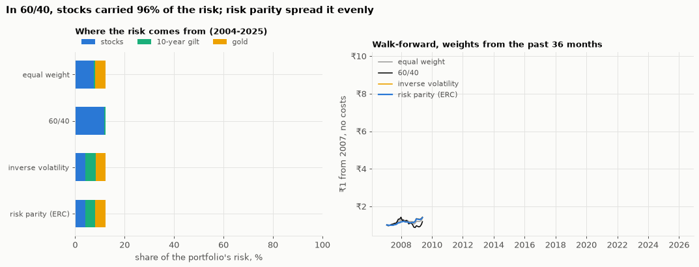
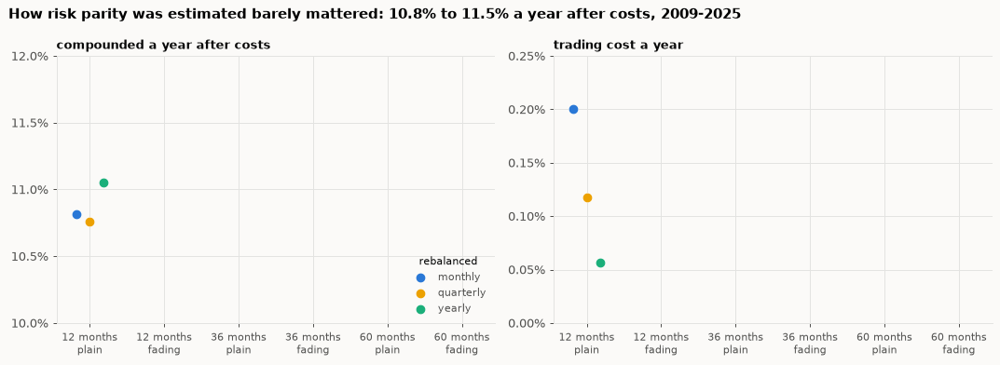

# Risk Parity

[](https://github.com/Dhirajdas18/risk-parity/actions/workflows/ci.yml)
[](https://dhirajdas18.github.io/risk-parity/)

Risk parity across Indian stocks, government bonds and gold, January 2004 to December 2025: stocks
and cash from IIM Ahmedabad's factor library, gilt returns built from RBI's month-end yields, and
gold in rupees from Yahoo Finance. Equal risk contribution against 60/40, leverage, estimation and
rebalancing out of sample, crises, minimum variance and maximum Sharpe, and a verdict.

**Live risk parity lab: [dhirajdas18.github.io/risk-parity](https://dhirajdas18.github.io/risk-parity/)**,
pick the assets, the years and the estimation window, and see risk parity's weights, each asset's
share of risk and growth against 60/40 and equal weight, computed month by month in your browser.

## Features

- [x] What risk parity does: equal risk contribution against 60/40, equal weight and inverse volatility
- [x] Leverage: unlevered risk parity, borrowing at Indian rates, and a volatility target
- [x] Estimation window, EWMA and rebalancing frequency, after costs, out of sample
- [ ] Crises: 2008, the 2013 taper, 2020 and 2022
- [ ] Risk parity against minimum variance and maximum Sharpe, out of sample
- [ ] Which assets: a short gilt, and how much gold's measurement matters
- [ ] Verdict: a portfolio-construction rule for the reference model beyond stocks

## Findings

### 1. In 60/40, stocks carried 96% of the risk; risk parity spread it evenly

<a href="docs/img/basics.png"><picture><source media="(prefers-reduced-motion: reduce)" srcset="docs/img/basics.png"></picture></a>

Monthly returns in rupees, January 2004 to December 2025 (264 months): stocks are IIMA's broad
market including dividends; the 10-year gilt is a par bond bought at each month-end at RBI's yield
and repriced a month later at the yield for its shorter life, plus a month's coupon; gold is COMEX
gold futures times the rupee rate, which leaves out India's import duty (it tracked the GOLDBEES ETF
with a monthly correlation of 0.87 and 11.9% against 11.7% a year from 2009); cash is IIMA's
risk-free rate. An asset's risk contribution is its weight times its covariance with the portfolio;
equal risk contribution (ERC) weights make those contributions equal. Full-sample weights describe
the period with hindsight; the walk-forward sets each month's weights from the previous 36 months
only and holds them for the month (January 2007 to December 2025), with no costs.

- **The three assets barely moved together.** Monthly correlations were −0.01 (stocks and gilt),
  −0.05 (stocks and gold) and −0.09 (gilt and gold). Stocks compounded 14.9% a year with 21.7%
  volatility, gold 14.7% with 16.7%, the 10-year gilt 7.1% with 6.9%, cash 6.3%.
- **60/40 was a stock portfolio.** With 60% in stocks and 40% in the gilt, stocks carried 96% of the
  risk; an equal split still left them 61%.
- **Risk parity put most of the money in the calmest asset.** Its full-sample weights were 18%
  stocks, 58% gilt and 24% gold, each carrying a third of the risk; with correlations near zero,
  inverse volatility gave almost the same weights.
- **Walk-forward, risk parity matched 60/40's return with half the volatility.** It compounded
  11.6% a year against 11.3%, with volatility of 6.4% against 13.0%, a Sharpe ratio above cash of
  0.77 against 0.41 and a worst fall of −8% against −39%. Equal weight compounded 12.7% (Sharpe
  0.70, worst fall −18%).

### 2. Levered 2x at the cash rate, risk parity beat 60/40; at about 5% over cash, the gain was gone

<a href="docs/img/leverage.png"><picture><source media="(prefers-reduced-motion: reduce)" srcset="docs/img/leverage.png"></picture></a>

Unlevered risk parity had half of 60/40's volatility, so to compare like with like it has to borrow.
Each month, the risk-parity portfolio is scaled so its forecast volatility equals 60/40's, both
forecast from the same past 36 months (leverage capped at 4 times, never reached), and the extra is
borrowed at IIMA's cash rate plus a spread; no trading costs, January 2007 to December 2025. Cash
compounded 6.4% a year over these months. For scale, Indian brokers' margin loans cost roughly
9.65% to 15% a year in 2025 ([ICICI Direct](https://www.icicidirect.com/margin-trading-funding),
[Zerodha](https://support.zerodha.com/category/trading-and-markets/margins/margin-trading-facility/articles/does-zerodha-offer-lower-mtf-interest-rate)),
about 3 to 8 points above cash. The test assumes the whole portfolio, gilts and gold included, can
be borrowed against.

- **It took about 2 times leverage.** On average ₹2.01 invested per rupee owned, between 1.47 and
  2.99 times; the most was in late 2008.
- **At the cash rate, levered risk parity beat 60/40.** It compounded 17.1% a year against 11.3%,
  with a worst fall of −25% against −39%. Its volatility came out at 14.6%, above 60/40's 13.0%,
  although the forecasts matched.
- **The borrowing rate decided the result.** Borrowing at cash + 3% gave 13.6% a year (Sharpe
  0.52); at cash + 8% it gave 8.1% (Sharpe 0.17), below 60/40's 11.3% and all stocks' 12.3%.
  Levered risk parity only grew as fast as 60/40 when borrowing cost 5.1% a year over cash, still
  with a smaller worst fall (−28%).
- **Without borrowing,** risk parity compounded 11.6% a year with 6.4% volatility and a worst fall
  of −8%: about 60/40's growth with half the swings.

### 3. How risk parity was estimated barely mattered: 10.8% to 11.5% a year after costs

<a href="docs/img/estimation.png"><picture><source media="(prefers-reduced-motion: reduce)" srcset="docs/img/estimation.png"></picture></a>

Eighteen versions of risk parity on stocks, the 10-year gilt and gold, all walk-forward over the same
204 months (January 2009 to December 2025, so even a 60-month window has data): the covariance
from the past 12, 36 or 60 months, either plain or with exponentially fading weights (a month 12
months old counts half as much as the latest), and trades every month, quarter or year back to the
target weights. Every rupee traded pays an assumed 0.25% one way; costs scale in proportion to it.
That is generous: buying an ETF through a zero-brokerage broker costs about 0.02% in stamp duty,
exchange and SEBI charges, and selling under 0.01%
([Zerodha charges](https://zerodha.com/charges); STT is 0.001% on selling most ETFs and nil on gold
and gilt ETFs, [Zerodha support](https://support.zerodha.com/category/account-opening/charges-at-zerodha/articles/stt-etfs)),
which leaves about 0.2% for the bid-ask spread, not measured here. Fund expense ratios and tax on
rebalancing gains are not included.

- **Every version compounded 10.8% to 11.5% a year after costs,** with volatility of 5.7% to 6.0%,
  Sharpe ratios of 0.73 to 0.83 and the same worst fall, −4%. One standard error of a 17-year
  average return at 5.8% volatility is about 1.4 points a year, twice that whole range.
- **Costs were small.** Monthly rebalancing on a 12-month window traded 40% of the portfolio a year
  and cost 0.20% a year; yearly rebalancing on 36 or 60 months traded 5% to 7% and cost 0.02% to
  0.04%.
- **Yearly rebalancing came out ahead before costs too:** on 36 months, plain, 11.4% a year against
  11.2% monthly, so costs explain little of its edge.
- **Fading weights changed nothing that matters:** within 0.1 points a year of the plain version at
  every window and frequency.
- **60/40 did well in these months.** Starting after the 2008 crash, it compounded 12.8% a year with
  11.2% volatility (Sharpe 0.59, worst fall −14%), more growth than risk parity but less per unit of
  risk.

## Quick start

```bash
uv sync
uv run python scripts/fetch_data.py   # IIMA, RBI yields and Yahoo gold -> data/
uv run rp report basics               # topics: basics, leverage, estimation
uv run python scripts/build_site.py   # risk parity lab -> site/index.html
uv run pytest
```

The data files are downloaded, not committed.

## Design

- `src/rp/iima.py`: IIM Ahmedabad's factor library (stocks and the risk-free rate).
- `src/rp/rbi.py`: RBI's month-end SGL yields by maturity from the Handbook editions.
- `src/rp/gold.py`: gold in rupees (COMEX gold times the rupee rate) and GOLDBEES from Yahoo, with
  retries.
- `src/rp/assets.py`: the monthly asset table; gilt returns by repricing a par bond.
- `src/rp/weights.py`: risk contributions, inverse volatility, equal risk contribution (cyclical
  coordinate descent), minimum variance and maximum Sharpe (SLSQP).
- `src/rp/backtest.py`: walk-forward portfolios from past months only, with turnover and costs,
  volatility forecasts, leverage at a borrowing rate, and summary statistics.
- `src/rp/rp.js`: the lab's browser copy of the covariance, ERC weights and walk-forward, tested
  against Python through Node.
- `src/rp/site.py`: the risk parity lab, one static Plotly page carrying the monthly returns.
- `src/rp/reports.py`: README findings, reproducible with `rp report <topic>`.
- Conventions: monthly simple returns in rupees; volatility √12 times monthly; growth compounded over
  calendar time; Sharpe ratios above IIMA's risk-free rate.
- Data: IIM Ahmedabad's Indian Fama-French-momentum data library (Agarwalla, Jacob and Varma, 2013,
  Four factor model in Indian equities market, IIMA Working Paper 2013-09-05); Reserve Bank of India,
  Handbook of Statistics on Indian Economy (month-end SGL yields); Yahoo Finance (GC=F, USDINR=X,
  GOLDBEES.NS).
- Charts: one validated palette; README charts are animated GIFs with a static fallback for
  reduced-motion users.

Research only, not investment advice. MIT licence.
